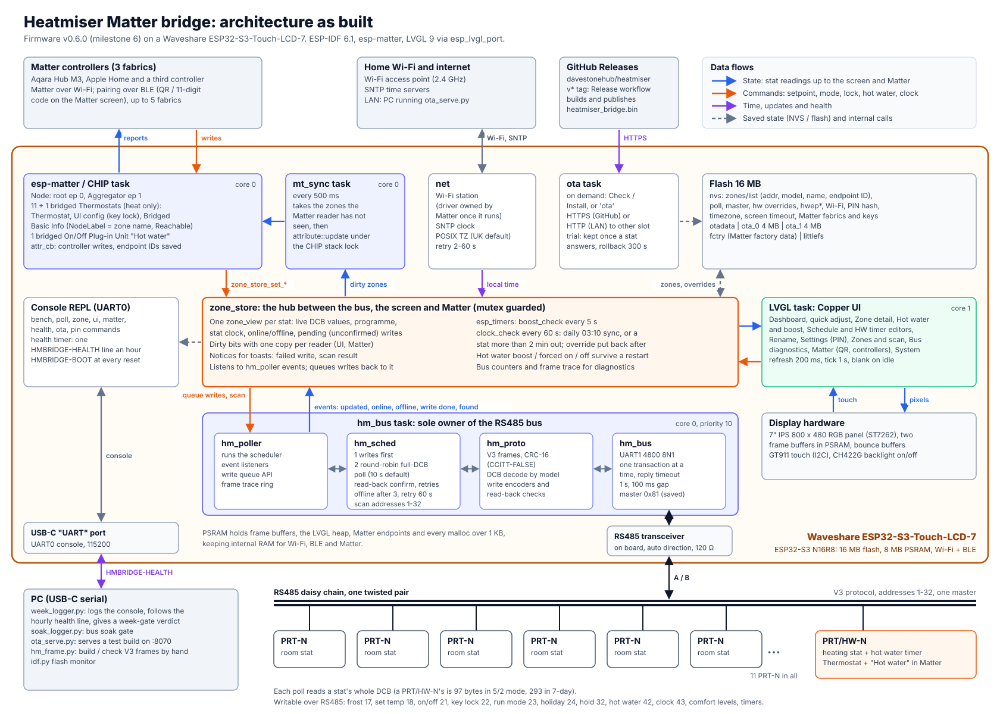
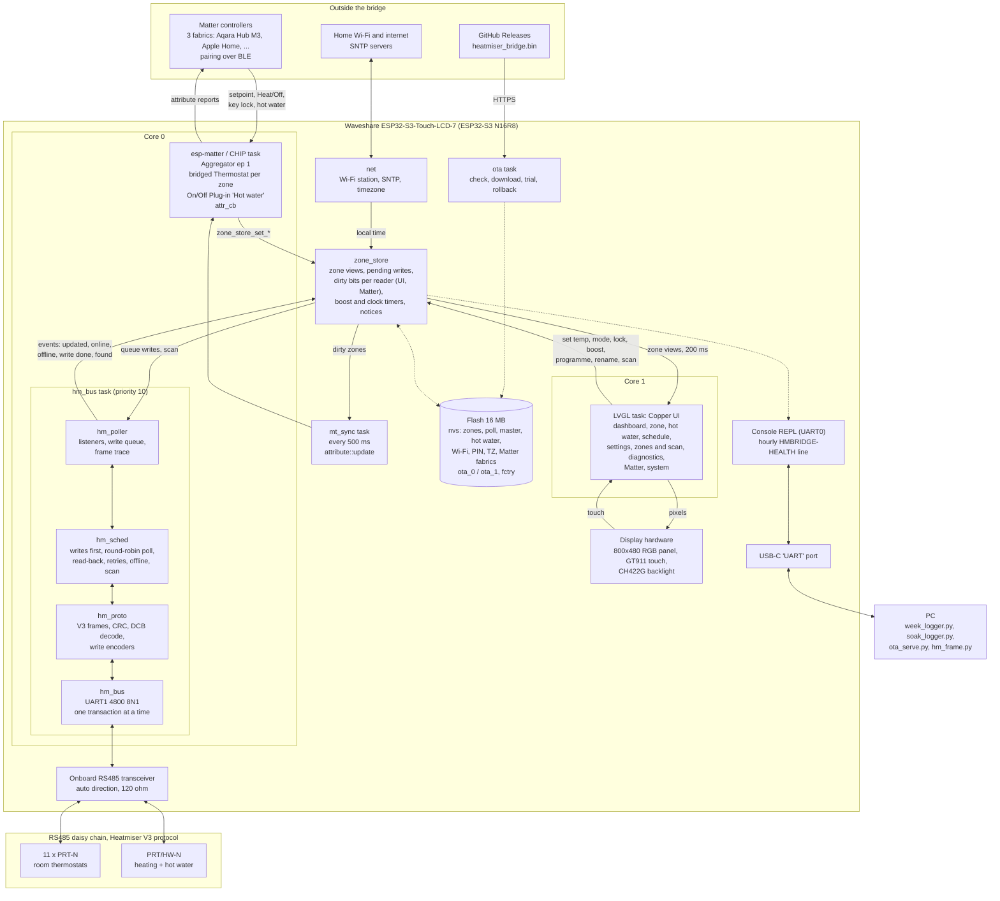

# Architecture as built

Firmware v0.6.0 (milestone 6) on the Waveshare ESP32-S3-Touch-LCD-7. This
describes the code on `main`; the original plan is in the project's *Heatmiser
Matter Bridge System Design* doc, and the places where the build differs from
it are listed at the end.

The drawing above is [architecture.svg](architecture.svg). The same structure
as a Mermaid diagram, which GitHub renders and which is easier to edit:

## How the parts fit together

**The bus task owns the wire.** `hm_poller` runs one FreeRTOS task, `hm_bus`,
pinned to core 0 at priority 10. Each slot it asks `hm_sched` what to do next:
a queued write first (sent, then confirmed by reading the whole DCB back, up
to 5 retries), otherwise the next stat in a round-robin full-DCB poll (10 s
default, 2 to 120 s saved in NVS). A stat that misses 3 polls is offline and is
retried once a minute. `hm_proto` builds and checks V3 frames (CRC-16
CCITT-FALSE, low byte first), decodes each model's DCB and encodes writes.
`hm_bus` drives UART1 at 4800 8N1 on GPIO16/15 through the board's
auto-direction RS485 transceiver, one transaction at a time, as master 0x81
by default.

**The zone store is the hub.** `zone_store` registers a listener on the
poller, so every reading, online/offline change, finished write and scan find
updates a `zone_view_t` for that stat under a mutex and sets a dirty bit.
Each reader (the UI and Matter) has its own copy of the dirty bits, so
neither steals changes from the other. Every change, from the screen or from
Matter, goes through a `zone_store_*` call that records it as pending and
queues the write on the poller; the view shows the requested value until the
stat confirms it, and a failed write becomes a notice the screen shows as a
toast. The zone list, names, Matter endpoint IDs, poll interval, master
address and hot water overrides are saved in NVS.

Three `esp_timer`s in the zone store do timed work: `boost_check` (every 5 s)
ends hot water boosts on time, including ones that were running before a
restart; `clock_check` (every 60 s) sets every stat's clock at 03:10 each day,
or straight away when one is more than 2 minutes out; and `restore_setpoints`
puts a setpoint override back after a clock write, because a stat drops it
when its clock changes.

**Matter.** esp-matter's CHIP task holds a root node, an Aggregator on
endpoint 1, a bridged Thermostat (heat only, with key lock and the zone name
as `NodeLabel`) for each stat, and an On/Off Plug-in Unit for the PRT/HW-N's
hot water. Endpoint IDs are saved and resumed at boot, so controllers keep
their rooms. Controller writes arrive in `attr_cb` (`PRE_UPDATE`) and go
straight to the zone store. A separate `mt_sync` task wakes every 500 ms,
takes the Matter reader's dirty zones and updates their attributes under the
CHIP stack lock, adding or removing endpoints when the zone list changes.
Commissioning is over BLE; the bridge is on 3 fabrics today.

**The screen.** The board component brings up the 800x480 RGB panel (frame
buffers in PSRAM, bounce buffers to stop drift), GT911 touch and the CH422G
backlight, and starts LVGL 9 through `esp_lvgl_port` on core 1. The `ui`
component builds every screen at start; a 200 ms LVGL timer takes the UI
reader's dirty zones and redraws what changed, and a 1 s timer drives clocks,
countdowns and screen blanking. `main/ui_platform.c` gives the UI what it
needs from Wi-Fi, OTA, Matter and NVS, which lets the same UI code run in the
desktop preview (`tools/ui_preview`).

**Network, time and updates.** Matter owns the Wi-Fi driver once it runs;
`net` attaches to it for status, SNTP and the timezone (UK by default), and
falls back to its own station mode if Matter does not start. `ota` checks
GitHub's `releases/latest` (or takes a LAN URL from `tools/ota_serve.py`),
downloads into the other 4 MB slot and restarts. The new firmware is on trial
until a stat answers: from 90 s it is kept as soon as one has, and if none
has by 300 s it rolls back.

**Console and health.** The console REPL on UART0 (the USB-C port marked
UART) has the bench, poll, zone, ui, matter, health, ota and pin commands.
Every hour the bridge prints one `HMBRIDGE-HEALTH` line (uptime, zones online,
bus counters, write and clock results, Wi-Fi, Matter fabrics, OTA state), and
`HMBRIDGE-BOOT` at every reset. `tools/week_logger.py` on the PC records the
console and judges the week-long gate from those lines.

### Boot order (`main/main.c`)

1. NVS.
2. `hm_bus` and `hm_poller` (paused), then `zone_store`, which restores the
   zones, adds them to the poller and starts polling.
3. `ota_init`, starting the trial of a new firmware if there is one.
4. The display and the UI; a display fault does not stop the bus.
5. Matter (endpoints are restored from the saved IDs before a controller can
   look), then `net` attaches to Matter's Wi-Fi.
6. The console.

### Tasks and timers

| Task or timer | Where | Core, priority | Job |
| --- | --- | --- | --- |
| `hm_bus` | `hm_poller` | 0, 10 | The bus: writes, polls, scans |
| CHIP / Matter | esp-matter | 0, stack default | Matter stack, BLE commissioning, Wi-Fi events |
| `mt_sync` | `matter_bridge` | any, 4 | Zone changes to Matter attributes every 500 ms |
| LVGL | `esp_lvgl_port` | 1, 4 | All screens; 200 ms refresh, 1 s tick |
| `ota` | `ota` | any, 3 | Check and download, on demand |
| `lcd_init` | `board` | 1, 5 | One-off: creates the RGB panel on core 1 |
| console REPL | ESP-IDF | default | Bench commands on UART0 |
| `zone_boost`, `zone_clock`, `zone_restore` | `zone_store` | esp_timer | Hot water boost end, clock sync, setpoint restore |
| `health` | `main/health.c` | esp_timer | Hourly health line |
| `ota_verify` | `ota` | esp_timer | Trial of a new firmware |
| `wifi_retry` | `net` | esp_timer | Wi-Fi reconnect back-off |

### Where the build differs from the design doc

- Changes reach Matter and the screen through per-reader dirty bits that each
  side polls (500 ms and 200 ms), not through `esp_event`.
- There is no separate `settings` component: settings live in `zone_store`
  (poll interval, master address), `net` (timezone), `main` (PIN, screen
  timeout) and the UI.
- Firmware updates (`ota`), the settings PIN and the health line were added
  in milestone 6.
