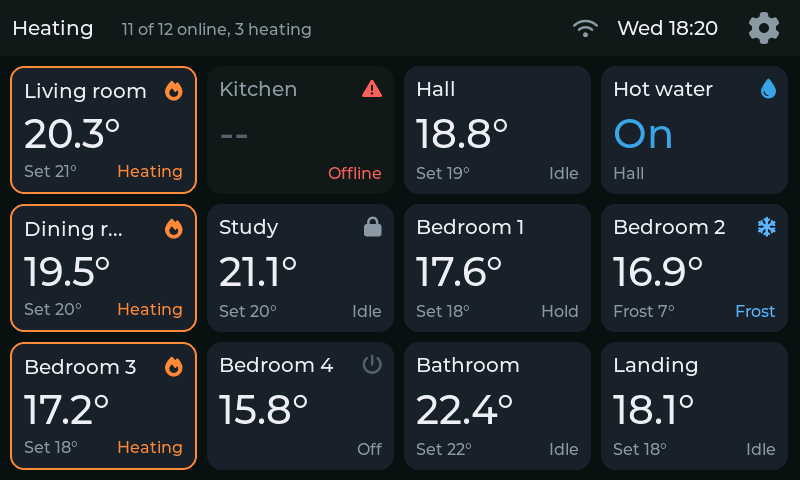

# Bench: milestone 3, the touchscreen

## Bench results (19 Nov 2026)

**Gate passed, on a shortened soak of 15 h 40 min.** Firmware d3baecc (the
Copper screens), drift test pattern on, Wi-Fi joined, house bus polling.

| Check | Result |
| --- | --- |
| Picture drift | None. The frame and the four corner squares were in place in the start and end photos, `drift_marks=0` all run, and nothing looked wrong at any check |
| Resets | None: one `HMBRIDGE-BOOT` (power on), uptime 15 h 40 min at the end |
| Wi-Fi | Up all run, 0 disconnects, RSSI -48 to -64 dBm; 12 of 55,800 pings lost (0.02 %) |
| Flash load | 1,860 NVS writes, 0 failures |
| Internal RAM | Lowest free 58,176 bytes, unchanged from the first minute to the end (no leak) |
| Display | About 38 frames a second, steady, 2.1 million frames |

The run was stopped at 15 h 40 min rather than 24 h. Drift on this panel
shows up in the first hours under Wi-Fi and flash load, and the low-water mark
for internal RAM did not move after the first minute, so the remaining hours
would add little.

Along the way: stat 2 (Emma's bedroom) came back. Its fault was in the UH1
wiring centre, now repaired; a scan at 15 h 20 min found it, and it confirmed
every write sent to it afterwards. All 12 stats are now on the bus. Several
scans run back to back kept stat 1 from being polled for long enough to mark
it offline once; it was back within a minute.

Milestone 3 puts the stats on the screen. The board now boots into a
dashboard of zone tiles driven by the poller, with a detail screen per zone
hot water, schedule, rename and settings screens, and a zones screen to
scan, name and remove stats. The look follows the Copper design doc. It remembers its zones
and their names across reboots, joins Wi-Fi for the clock, and has a drift
test pattern for the soak.

**Gate:** no picture drift during a 24 hour soak with Wi-Fi on. The drift test
pattern makes drift easy to see and logs a status line every 10 minutes.

Allow about 45 minutes for sections 0 to 5, then leave the soak running for a
day.

## What's on the screen



These are from the desktop preview (`tools/ui_preview`) with made-up rooms;
more in [screens/](screens/).

| Screen | What it shows | What you can do |
| --- | --- | --- |
| Dashboard | A tile per stat: name, room temperature, setpoint, flame when heating, padlock, offline (dashed) or fault tile; a hot water tile after the PRT/HW-N. 4 across, 3 down, scrolls past 12. Wi-Fi and clock in the header | Tap a tile to open the zone or hot water. Long-press a zone for a quick +/- popup. Sliders icon for Settings |
| Zone | Setpoint dial, room temperature, sensor, floor temperature if fitted, hold or holiday, faults, last update | Dial and +/- buttons, Heat / Frost / Off, hold Off / 1 h / 4 h / 24 h, key lock, Schedule; pencil to rename |
| Hot water | On or off, why (timer, forced, boost), the next switch, today's timer as a strip | Resume timer, Force on, Force off, boost 30 / 60 / 120 min, Edit timer |
| Schedule | The four comfort levels (or hot water on/off times) for Weekdays and Weekend, or each day in 7-day mode, and a 24 h profile | Tap a time or temperature to change it, or mark a level Not used; Copy to the other days |
| Rename | The name with a 16 character counter | On-screen keyboard; the default-name key puts back "Zone N" |
| Settings | Timezone, units, poll interval, master address, display timeout, PIN | Change timezone, poll interval and timeout; Zones and scan, Bus diagnostics, System; Sync clocks now, Holiday for all zones, Factory reset |
| Zones and scan | Scan progress over addresses 1 to 32, every saved stat with model and state | Scan, tap a name to rename, Identify (blinks the stat's padlock), Remove |
| Bus diagnostics | Polls, timeouts, CRC errors and last seen per stat, the last bus frames | Clear counters, Single read |
| System | Wi-Fi, clock, uptime, memory, frames drawn, firmware | Drift test pattern on or off |

Units are fixed at °C, the master address is shown only, and PIN and Matter
say they come later.

Setpoint taps wait 0.7 s after the last tap before going on the bus, so five
taps make one write. Until the stat confirms a change the screen shows
"Setting..." or "..."; if the stat does not take it, the screen goes back to
what the stat reports and a message says why at the bottom.

The screen goes dark after 10 minutes without a touch (changeable on the
System tab). The touch that wakes it does nothing else, and it wakes to the
dashboard.

## 0. Build and flash

This build turns on PSRAM, changes the partition table and pulls in LVGL from
the ESP component registry, so start from a clean configuration once. From an
ESP-IDF prompt in the repo:

```
git pull
del sdkconfig
idf.py fullclean
idf.py set-target esp32s3
idf.py build
idf.py -p COM5 erase-flash
idf.py -p COM5 flash monitor
```

(`rm sdkconfig` instead of `del` outside Windows.) The erase is a one-off: the
new partition table puts settings storage where the old firmware's code was.
Nothing from milestones 1 and 2 was stored on the board, so nothing is lost. The first build downloads
LVGL 9.4, esp_lvgl_port and the GT911 touch driver into `managed_components/`,
so it needs the internet and takes a few minutes. Your old `sdkconfig` from
milestone 2 would keep PSRAM off and the screen would not start, which is why
it goes.

You should see, in this order: `HMBRIDGE-BOOT`, `display up: 800x480, 16 MHz,
bounce 10 lines, touch GT911`, then the `hm>` prompt. The backlight comes on a
moment after the first frame is drawn.

| What you see | Meaning |
| --- | --- |
| `CH422G not answering on I2C` | The IO expander that drives the backlight did not answer. Power cycle the board; if it persists, send me the boot log. |
| `GT911 touch not found` | Screen works without touch. Send me the log line before it. |
| Screen lit but black, or garbage | Send me the log from boot. Check `display` on the console says frames are being drawn. |
| Colours wrong | Look at the drift pattern's corner squares (section 6). They should be green top left, blue top right, yellow bottom left, magenta bottom right. Tell me what you see. |

## 1. Find the stats

The dashboard says "No thermostats yet". Tap **Scan for thermostats** (or the
sliders icon, **Zones and scan**, then **Scan the bus**). The zones screen
shows progress over addresses
1 to 32 and should find 11 stats in about 15 seconds; stat 2 will not answer,
as before. Every stat found is saved and starts polling at once.

To keep stat 2 on the dashboard as an offline tile, add it by hand:

```
zone add 2
```

It shows a grey **Offline** tile and costs one timeout a minute on the bus.
`zone remove 2` takes it off again. Leave it off if you prefer.

## 2. Name the zones

On **Zones and scan**, tap a zone's name and type the name you noted from
the Touchpad (16 characters at most), then **Save**. Or, quicker for
eleven of them, use the console:

```
zone name 1 Living room
zone name 3 Hall
...
zone
```

`zone` lists every zone with its name, model, link, room temperature,
setpoint and mode.

**Identify** toggles a stat's key lock four times, about 2.5 s apart, so its
padlock blinks; it ends as it started. Use it to check which room a stat is
in.

## 3. Use it

Pick a stat you can see:

1. Tap its tile. The zone screen should show the same room temperature and
   setpoint as the stat.
2. Tap + twice. The setpoint shows "Setting..." and, about a second later,
   the stat's own display follows and the screen settles on the new value.
   Put it back with -.
3. Drag the dial. Same result, one write when you let go.
4. Tap **Frost**, then **Heat**, then **Off**, then back. The stat should
   follow each one; the dial greys out in Frost and Off.
5. Under **HOLD**, tap **1 h**. The info card shows the hold time left.
   Then **Off**.
6. Tap **Key lock** to lock the keys, check the padlock on the stat, then
   tap it again to unlock.
7. Back on the dashboard, long-press a tile. The popup's +/- change the
   setpoint the same way; it closes after 5 seconds or a tap outside.
8. Tap the hot water tile. **Force on** should turn the hot water on at the
   PRT/HW-N (address 3), **Force off** off, and **Resume timer** hands it
   back to its programme. **30 min** boosts it; the header counts down and
   the stat goes back to its timer when the boost ends (or at once if you
   tap the boost again).
9. Tap **Schedule** on a zone. The levels should match the stat's own
   programme. Change one time by 10 minutes, tap **Set**, and check the stat
   shows it; then put it back.
10. In **Settings**, **Bus diagnostics** should show every stat's poll count
    rising and the frames going by.

Pull the bus pair from the board for a minute to see the tiles go to
**Offline** after three missed polls (about 30 s), then plug it back in.

## 4. Wi-Fi and the clock

```
wifi join "Your network" "your password"
wifi
```

`wifi` should show the network, an IP address, the signal and, within a
minute, the clock with "BST" or "GMT". The clock appears in the dashboard
header and the Wi-Fi icon turns grey (red means not connected). The network is
saved; it rejoins after a reboot and retries with back-off if the router goes
away. The timezone defaults to UK time; `tz` changes it.

Wi-Fi set-up from the screen comes with Matter commissioning in milestone 4.

## 5. Reboot

Press the reset button. The dashboard should come back with every zone and
name, and the tiles fill in as each stat is read (about 10 s).

## 6. The 24 hour soak (the gate)

Set the board up where it will run, on its 5 V supply, with the bus connected
and Wi-Fi joined. Then turn on the drift test pattern: sliders icon,
**System**, **Drift test pattern**. (Or `display soak on`.)

The pattern draws a white 1 px frame on the outermost pixels with a red frame
2 px inside it, a coloured square in each corner, an orange bar sliding along
the bottom, and a status line. While it is on:

- the screen never blanks;
- the board pings the router every second and writes to flash every 30 s, to
  load Wi-Fi and flash the way OTA and settings changes will;
- the poller carries on as normal;
- a `DSOAK` line goes to the console every 10 minutes.

Capture the console to a file for the whole run. In PowerShell:

```
idf.py -p COM5 monitor | Tee-Object -FilePath soak3.log
```

Take a photo of the screen at the start. Look at it a few times over the day,
and take another photo at the end.

**What drift looks like:** the picture is shifted sideways, so the white line
is missing from one side and appears a few pixels in from the other, or the
corner squares are not in their corners. It usually starts during Wi-Fi or
flash activity and stays until reset.

If you see drift, press **Picture shifted** on the pattern. That writes a
`DSOAK DRIFT-REPORTED` line to the log and restarts the panel's DMA. Note
whether the picture came back straight.

The gate passes when, after 24 hours:

- the picture never drifted (the photos match, no `DRIFT-REPORTED` lines);
- `HMBRIDGE-BOOT` appears only once in the log (no resets);
- the `DSOAK` lines show `wifi=up` and `ping_lost` small compared with
  `ping_ok`;
- `int_min`, the lowest free internal RAM, has stopped falling.

Turn the pattern off afterwards (the same button, or `display soak off`), which prints
a final `DSOAK end` line.

## What to send back

1. The start and end photos, and any of drift.
2. The first and last `DSOAK` lines (or the whole `soak3.log`).
3. `zone` output after naming.
4. Anything odd: a tile that didn't update, a write that didn't take, touch in
   the wrong place, a slow screen.

## Console reference (new in milestone 3)

| Command | Does |
| --- | --- |
| `zone` | List the zones with their live values and any pending change |
| `zone name <addr> <name>` | Rename a zone (saved) |
| `zone add <addr>`, `zone remove <addr>` | Add or forget a zone (saved); removing does not change the stat |
| `wifi`, `wifi join <ssid> [password]`, `wifi forget` | Wi-Fi status and clock; join or forget a network |
| `tz [POSIX TZ]` | Show or set the timezone, e.g. `tz GMT0BST,M3.5.0/1,M10.5.0` |
| `display` | Backlight, frames drawn, blank timeout, soak state, free memory |
| `display soak on/off/now` | Drift test pattern and load; `now` prints a DSOAK line |
| `display timeout <s>` | Blank after this many seconds idle, 0 = never (saved) |
| `display backlight on/off`, `display restart` | Backlight; restart the panel DMA |
| `screen dash`, `screen zone/schedule/timer/hotwater/rename <addr>`, `screen settings/zones/diag/system` | Show a screen without touching it |

`poll`, `set`, `gate` and the milestone 1 commands still work. A `poll scan`
from the console adds what it finds to the saved zones too; `poll add` and
`poll remove` do not, so use `zone add` and `zone remove` instead.
